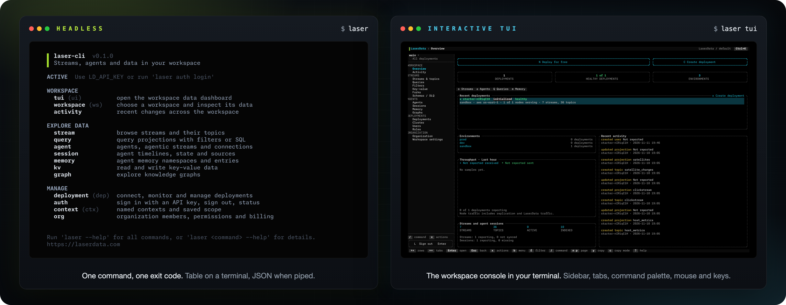

# Laser CLI

Public release artefacts for `laser`, the command-line interface and terminal dashboard for [LaserData](https://laserdata.com) Cloud. It follows the LaserData console: an organization, its workspaces, their deployments, and the data inside each deployment, from streams and topics to agents, agent sessions, memory, queries, consumer filters, key-value namespaces and forks. One static binary for macOS arm64 and Linux x86_64 or arm64.



## Install

```sh
curl -fsSL https://cli.laserdata.cloud/install.sh | sh
```

The installer detects OS + arch, downloads the matching archive from the latest release, verifies the SHA-256 checksum, and drops `laser` into `$HOME/.local/bin` (or `$LD_PREFIX` if set). Re-run any time to upgrade.

### Flags (`sh -s --`)

| Flag | Effect |
| --- | --- |
| `--to <dir>` | Install dir (default `$HOME/.local/bin`) |
| `--version <vX.Y.Z>` | Pin release tag (default latest) |
| `--with-cc-skills` | Also install/update the Claude Code skill pack from `cli.laserdata.cloud/claude.sh` |
| `--help` | Show help |

### Env vars

| Var | Effect |
| --- | --- |
| `LD_VERSION` | Pin tag |
| `LD_PREFIX` | Override install dir |

### Recipes

```sh
# Pin a version.
curl -fsSL https://cli.laserdata.cloud/install.sh | sh -s -- --version v0.1.0

# Bundle Claude Code skills in the same step.
curl -fsSL https://cli.laserdata.cloud/install.sh | sh -s -- --with-cc-skills

# Pinned version + custom dir + skills.
curl -fsSL https://cli.laserdata.cloud/install.sh \
  | sh -s -- --version v0.1.0 --to /usr/local/bin --with-cc-skills
```

Re-running the installer replaces the binary and each installed skill in place.

In-place upgrades from an existing install:

```sh
laser update
```

`laser update` downloads the latest release and replaces the binary. `laser version` prints the installed version.

## Two modes, one binary

Both modes share the same configuration and credentials.

### Headless (default)

`laser <command>` runs one command and exits. Output is a table on a terminal and JSON when piped. Failures exit non-zero with the error on stderr, so commands compose with `&&`, `||`, `xargs`, cron and CI runners.

```sh
laser auth login                  # prompts for the API key, binds its organization
laser workspace use main          # remember the workspace
laser deployment list             # every deployment of the workspace, with live health
laser deployment use sensors      # scope data commands to one deployment
laser stream list                 # streams of the scoped deployment
laser session list --status active
laser deployment list --silent && echo ok
```

| Flag | Effect |
| --- | --- |
| `-o table`, `json`, `yaml`, `name` | Output format. Table on a terminal, JSON when piped |
| `--silent` | No output on success. Failures still reach stderr |
| `--page`, `--results` | Paging of list commands. 25 per page by default, at most 100 |
| `--yes` | Skip the confirmation of destructive commands |
| `--context <name>` | Use a named context for one invocation |
| `--debug` | Debug logging to stderr |

| Exit code | Meaning |
| --- | --- |
| 0 | Success |
| 1 | Invalid input, configuration or scope |
| 2 | The API refused the request, or the command line itself is invalid |
| 3 | Network or file error |
| 4 | A remote operation failed, was refused, or did not finish in time |
| 70 | Internal error, such as a failed `laser update` |
| 130 | Interrupted |

The command groups follow the console's navigation:

| Console | Commands |
| --- | --- |
| Organization | `org` with `member`, `invitation`, `role`, `key`, `cloud-account`, `billing`, `notification`, `audit`, `settings` |
| Workspace | `workspace`, `env`, `activity`, `find <text>` |
| Deployments | `deployment` with `create`, `monitor`, `connect`, `connector`, `backend`, `settings`, `cluster`, `client`, `user`, `role` |
| Agents | `agent`, `session`, `conversation`, `memory`, `graph` |
| Streams | `stream`, `topic`, `group`, `message`, `query`, `projection`, `filter`, `kv`, `fork`, `schema`, `dlq` |

`laser <group> --help` lists every command and flag. The full reference is at <https://docs.laserdata.com/cli/commands>.

### TUI

```sh
laser tui            # or: laser ui
laser tui -w main -d sensors
```

The LaserData console in the terminal: the workspace sidebar, pages with tabs, a command palette (`Ctrl+K`), mouse and keyboard control. Every row opens its data, from a stream to its topics, partitions and messages, from an agent to its sessions, timeline, memory and graph. Every view runs a command you could type. Without a saved key it opens on a welcome screen and asks for one. Press `?` for the keyboard shortcuts. The full guide is at <https://docs.laserdata.com/cli/tui>.

## Claude Code skills

If you drive `laser` from inside [Claude Code](https://code.claude.com/docs/en/overview), install the official skill pack.

One-shot with the binary:

```sh
curl -fsSL https://cli.laserdata.cloud/install.sh | sh -s -- --with-cc-skills
```

Or via the Claude Code marketplace:

```
/plugin marketplace add laserdata/laser-cli-claude
/plugin install cli@laser
```

Or skills only:

```sh
curl -fsSL https://cli.laserdata.cloud/claude.sh | sh
```

Adds slash commands like `/laser-onboard`, `/laser-deploy`, `/laser-query`, `/laser-troubleshoot`. Source: <https://github.com/laserdata/laser-cli-claude>. Every skill is listed at <https://docs.laserdata.com/cli/claude-skills>.

## Authentication

```sh
laser auth login
```

The CLI signs in with an API key, generated at <https://laserdata.cloud>. A key belongs to one organization, and `auth login` binds it: the organization is discovered from the key, so no organization id is needed. A key scoped to one workspace selects that workspace. The key is stored in the OS keyring (Keychain on macOS, Secret Service on Linux).

For scripts and agents no saved context is needed. Set the key and the scope in the environment, pass `-o json`, and check the exit code:

```sh
export LD_API_KEY=...
export LD_WORKSPACE=main
export LD_DEPLOYMENT=sensors
```

`--workspace`/`-w` and `--deployment`/`-d` set the scope for one command and accept an id or a name.

## Local state

| Path | Content |
| --- | --- |
| `$XDG_CONFIG_HOME/laser/config.toml` | Named contexts with their organization, workspace and deployment scope, mode 0600. API keys live in the OS keyring, only their names are stored here |
| `$XDG_STATE_HOME/laser/active` | The name of the active context |
| `$XDG_DATA_HOME/laser/logs/laser-YYYY-MM-DD.log` | Daily debug log |

macOS uses the platform equivalents. `LD_LOG_FILE` sets the file log level and `LD_LOG` the stderr level.

## Releases

Each release on this repo ships:

- `laser-<ver>-x86_64-unknown-linux-gnu.tar.xz` + `.sha256`
- `laser-<ver>-aarch64-unknown-linux-gnu.tar.xz` + `.sha256`
- `laser-<ver>-aarch64-apple-darwin.tar.xz` + `.sha256`
- `install.sh` + `install.sh.sha256`

Report a bug or request a feature: <https://github.com/laserdata/laser-cli-releases/issues>.

## Documentation

<https://docs.laserdata.com/cli>

## License

Source code is private. The binary distributed here may be used per the LaserData terms of service.
